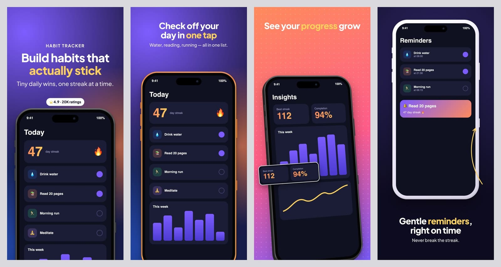
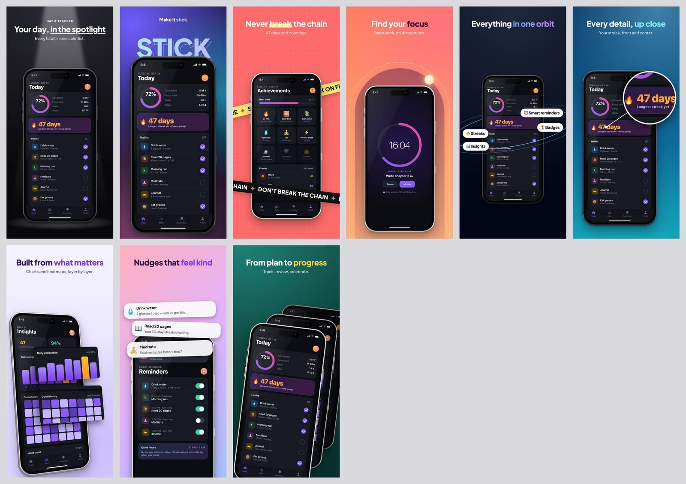
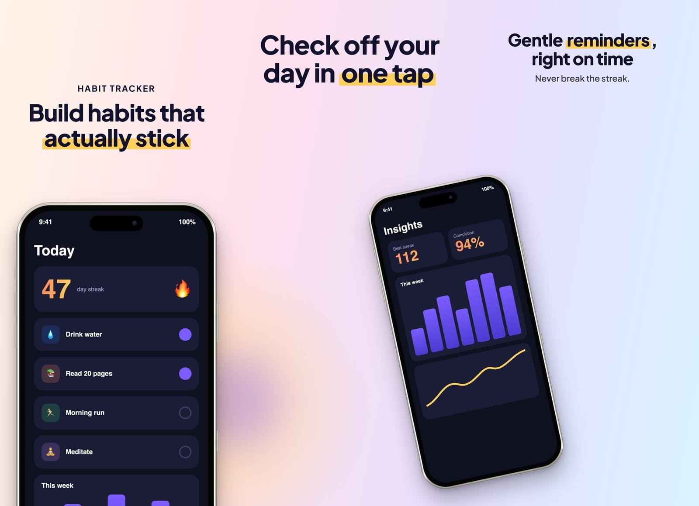
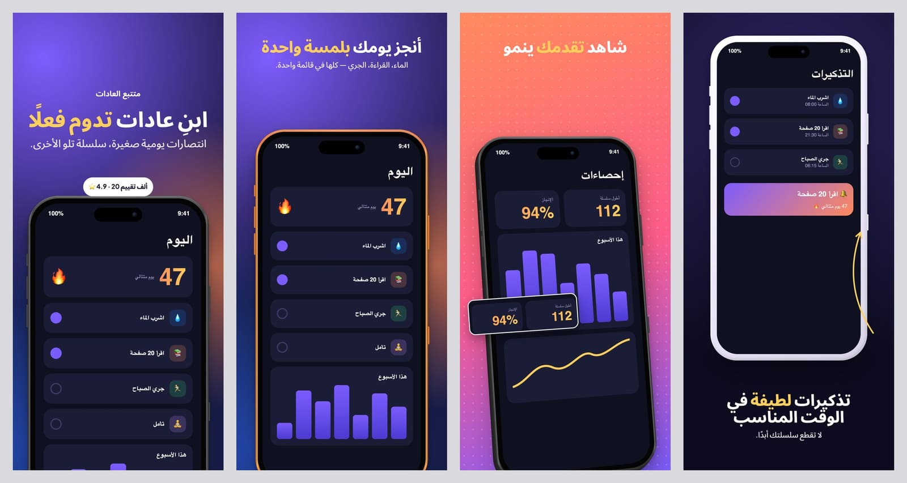
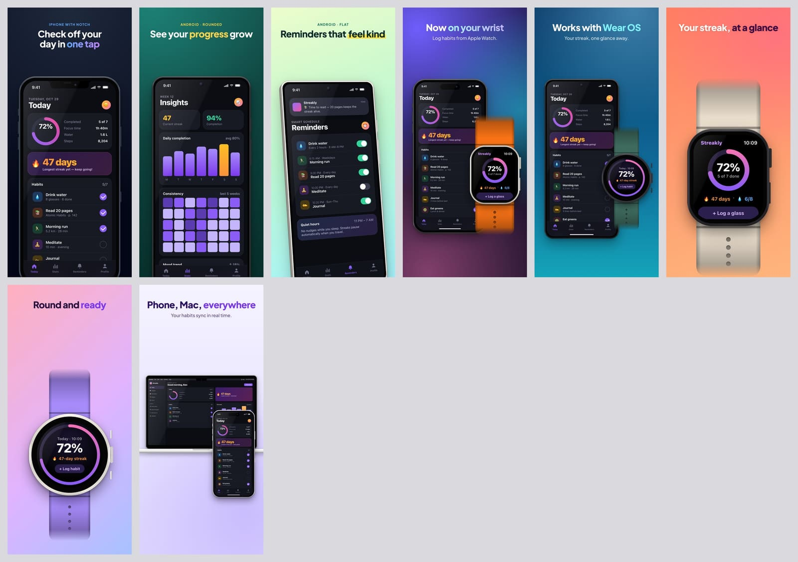
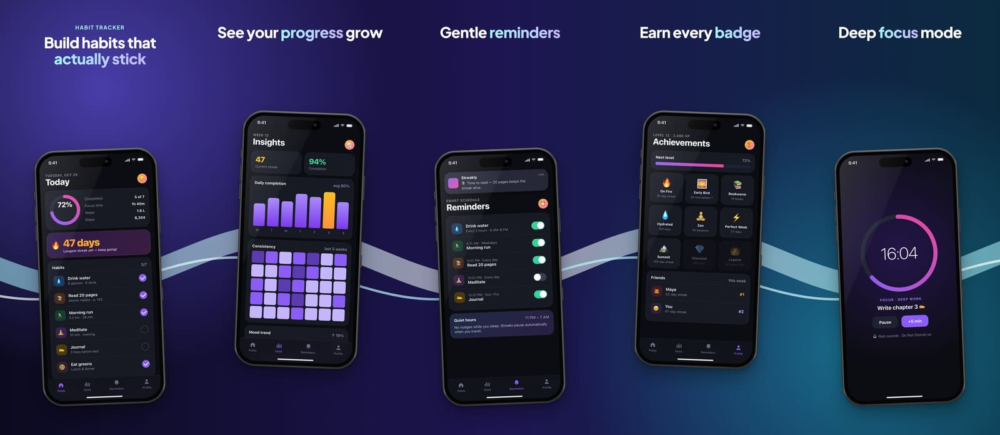
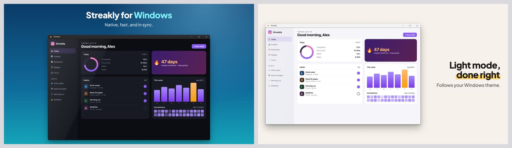

# App Screenshots Pro Skill

A Claude Code skill that turns your app into App Store and Google Play screenshots. Claude reads the codebase, writes benefit-led captions in every language you ship, and renders framed, localized, store-valid images from one JSON config. It runs locally, is free, and can run in CI.



**Showcase:** [dtthaison.github.io/app-screenshots-pro-skill](https://dtthaison.github.io/app-screenshots-pro-skill/) has every layout, panorama pattern, device and language, rendered by the skill.

## What it does

- **Reads your app.** Name, features, brand colors, fonts and existing translations come from the code: iOS, Android, Flutter, React Native, Expo or web.
- **Writes the copy.** Captions sell benefits, not screens, and are translated into every locale with per-language fixes. Right-to-left languages (Arabic, Hebrew) are laid out right to left, and CJK, Thai and Indic text get matching fonts.
- **Draws the devices in CSS.** iPhone (Dynamic Island, notch, Home button), iPad, Android phone and tablet, Apple Watch, Wear OS, MacBook, iMac-style desktop, and Mac, Windows and browser windows. Styles are real, clay, outline or frameless, in any color, with 3D tilt. No mockup files to download.
- **41 layouts and 15 panorama patterns.** These include hero, tilt, before/after, mosaic, feature grid and reviews, plus signature layouts (spotlight, big-type, ticker, arch, orbit, lens, layers, notify, deck) and connected panoramas whose phones span two slides.
- **35 store sizes.** Every current App Store, Play, Mac App Store, Microsoft Store, Apple Watch and Wear OS size, plus social formats (OG image, X, Product Hunt, Instagram, Story).
- **Checks the output against store rules.** Exact pixel sizes, no alpha channel, per-store screenshot count and file size limits. It also warns when text is clipped, covered by a device, shrunk below 90%, or about to fall in a panorama seam.
- **Ready to upload.** `--fastlane` writes the folder layout that `fastlane deliver` and `supply` expect.

| Signature layouts | Connected panorama |
|---|---|
|  |  |

| Right-to-left (Arabic) | Phone, watch and laptop |
|---|---|
|  |  |




## Install

### As a Claude Code plugin

```text
/plugin marketplace add dtthaison/app-screenshots-pro-skill
/plugin install app-screenshots-pro-skill@app-screenshots-pro-skill
```

### As a personal skill

```bash
git clone https://github.com/dtthaison/app-screenshots-pro-skill.git
ln -s "$PWD/app-screenshots-pro-skill/skills/generating-app-screenshots" ~/.claude/skills/generating-app-screenshots
```

### Requirements

- Node.js 18.17 or newer
- Google Chrome or Microsoft Edge. If you have neither, run `npx playwright install chromium`, or set `CHROME_PATH`.
- Internet access while rendering, for Google Fonts.

Dependencies (`playwright-core`, `sharp`) install themselves the first time the skill runs. To install them by hand:

```bash
cd skills/generating-app-screenshots && npm install
```

## Use

Ask Claude in your app's repository:

> Make App Store and Play screenshots for this app in English, Vietnamese and German.

The skill takes it from there:

1. Reads the app.
2. Collects screens: simulator captures, PNGs you supply, or HTML mocks rebuilt from your UI code.
3. Writes `copy.json` and `screenshots.config.json`.
4. Renders the set.
5. Reviews every preview and fixes what it finds.
6. Reports what still needs a person, such as native-speaker review and replacing any mocks with real captures.

### Run the renderer yourself

```bash
node skills/generating-app-screenshots/scripts/render.mjs path/to/screenshots.config.json \
  [--locales en-US,vi] [--targets ios-6.9,android-phone] [--slides hero] \
  [--format png|jpeg|webp] [--fastlane] [--no-preview]
```

The renderer writes:
- `out/<target>/<locale>/NN_<slide>.png`: the store images.
- `out/_preview/*.jpg`: contact sheets. For panoramas there is also a store-card view.
- `out/index.html`: a page that shows everything.

A minimal config:

```json
{
  "app": { "name": "Streakly" },
  "locales": ["en-US", "de"],
  "targets": ["ios-6.9", "android-phone"],
  "strings": "copy.json",
  "theme": { "preset": "aurora", "font": { "family": "Plus Jakarta Sans" } },
  "slides": [
    { "id": "hero", "layout": "hero", "title": "@hero.title", "screen": "screens/home.png" },
    { "id": "stats", "layout": "tilt-right", "title": "See your **progress** grow", "screen": "screens/stats.png" }
  ]
}
```

The full schema is in [`references/config.md`](skills/generating-app-screenshots/references/config.md).

## Examples

| Folder | Shows |
|---|---|
| [`examples/demo`](skills/generating-app-screenshots/examples/demo) | A normal set and a panorama set in 5 locales (en, vi, de, ar, ja) |
| [`examples/gallery`](skills/generating-app-screenshots/examples/gallery) | Every layout with a different preset ([preview](docs/images/layouts.jpg)) |
| [`examples/signature`](skills/generating-app-screenshots/examples/signature) | The 9 signature layouts |
| [`examples/panorama-patterns`](skills/generating-app-screenshots/examples/panorama-patterns) | All 15 panorama patterns |
| [`examples/devices`](skills/generating-app-screenshots/examples/devices) | Watch, Wear OS, Mac, Windows and cross-device slides |

Rebuild the showcase site (`docs/`) after rendering the examples with `npm run examples && npm run site`.

Render one example:

```bash
cd skills/generating-app-screenshots
npm install
npm run example:demo
open examples/demo/out/index.html
```

## Repository layout

```text
.claude-plugin/                  plugin + marketplace manifests
skills/generating-app-screenshots/
  SKILL.md                       what Claude reads first
  references/                    config schema, copy & locale rules, how to read each stack, research notes
  scripts/render.mjs             the renderer (CLI)
  scripts/{layouts,panorama,devices,targets,presets}.mjs
  examples/                      runnable configs with mock screens
docs/                            GitHub Pages showcase (built by scripts/build-site.mjs) + README images
```

## Limits

- HTML mock screens are for drafts. Apple and Google want the real app UI, so replace mocks with simulator or device captures before you submit.
- The device frames are drawn in CSS and only resemble real hardware. They are not Apple or Google artwork.
- Rendering takes about 4 seconds per image.

## Contributing

See [CONTRIBUTING.md](CONTRIBUTING.md).

## License

[MIT](LICENSE). Apple, iPhone, iPad, Mac, Apple Watch, App Store, Google Play, Android, Wear OS and Windows are trademarks of their owners. This project is not affiliated with or endorsed by any of them.
